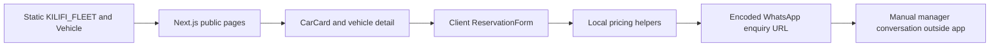
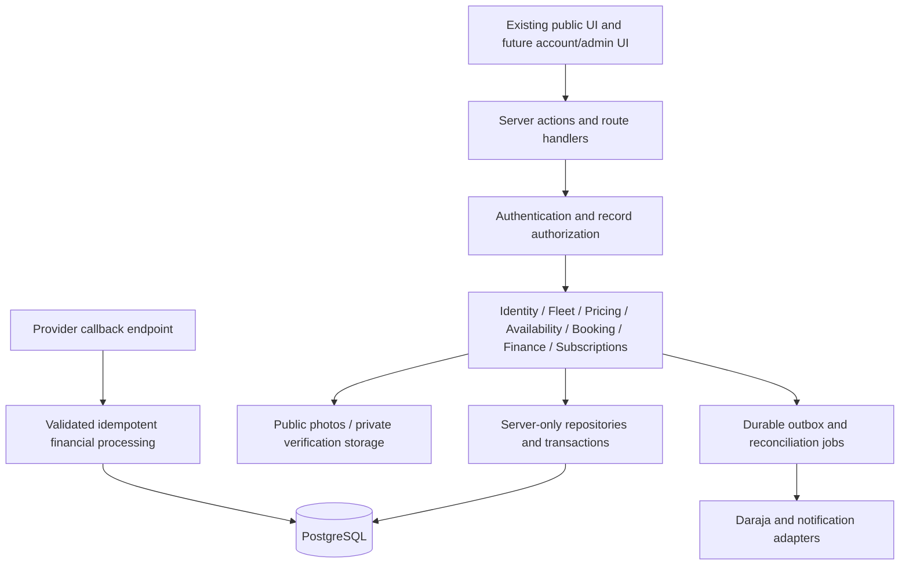

# KiliRide architecture: Phase 0 proposal

## Phase 1 local implementation addendum

The Phase 0 assessment below remains historical evidence. Phase 1 was authorized locally through CODEX_PROMPT_002. Implemented: modular Next.js auth Route Handler, Better Auth 1.7.14 with Prisma 7.10.1/PostgreSQL adapter, isolated PostgreSQL 17 development/test containers, Mailpit, server-only env/DB/auth/authorization modules, minimal protected account/host/admin pages and an audited host activation service. PostgreSQL is local, not managed hosting. No fleet records moved.

Next.js and matching ESLint configuration were updated within major 16 to 16.4.3 based on npm security findings; React remains 19.2.3. Better Auth's published peers cover Next 16, React 19 and Prisma 7. Prisma CLI/client/driver are pinned to the same stable version; the registry's Prisma 8 release candidate was not selected. Official references: [Better Auth Prisma](https://better-auth.com/docs/adapters/prisma), [Next integration](https://better-auth.com/docs/integrations/next), [MFA](https://better-auth.com/docs/plugins/2fa).

Authentication uses database sessions with HTTP-only cookies, verification before login, hashed password handling delegated to Better Auth, hashed verification identifiers, password-reset revocation and real rate limiting. Cookie cache is disabled so revocation is checked against the database. Local HTTP is intentional; hosted TLS and deployment are not configured. The local safety guard rejects remote databases and mail endpoints; production build success does not authorize production execution.

CUSTOMER assignment is an atomic database trigger. Application role assignments are separate from Better Auth public user input; no admin plugin or public role-management API is enabled. ADMIN provisioning is a local operator command requiring verified email and MFA and revoking old sessions. All admin requests also recheck MFA, role and post-grant session age. Host activation requires ADMIN and a matching Origin. Own-account reads reject cross-account access. Audit rows cannot be edited/deleted through ordinary application SQL.

Identity flows now coexist with the unchanged static catalogue and pricing. No booking, payment, subscription or fleet-management backend was introduced. Local database operation, recovery and provisioning are documented in KILIRIDE_LOCAL_SETUP.md; final check outcomes and residual development-tool advisories are in KILIRIDE_PHASE1_REPORT.md.

Date: 2026-10-29. All target choices are proposed until approved. No infrastructure or schema was created.

## Actual architecture

Evidence: `src/lib/fleet.ts`, `src/lib/types/vehicle.ts`, `src/app/page.tsx`, `src/app/services/vehicles/page.tsx`, `src/app/vehicles/[id]/page.tsx`, `src/components/bookings/ReservationForm.tsx`. No DB, API, account service or durable booking exists. A Next.js server-rendered route is not evidence of a transactional backend.

## Proposed architecture

Use a modular Next.js monolith: one deployable application, explicit server-only services, input schemas, public DTOs and repositories. Proposed modules under `src/server/` are identity, fleet, pricing, availability, booking, payments, subscriptions, admin and notifications; not scaffolding to create during the audit. Direct server rendering should call services rather than loopback HTTP. Keep externally needed endpoints, such as provider callbacks, as thin route handlers. Centralize authorization and limit data returned to clients, consistent with [Next.js authentication guidance](https://nextjs.org/docs/app/guides/authentication).

### Storage and identity choices

| Decision | Recommendation and rationale | Tradeoff / approval gate |
|---|---|---|
| Database | Managed PostgreSQL: transactions, foreign keys and range exclusion suit rental inventory; no legacy DB requires migration. | Recurring service/backup cost, connection pooling and regional privacy review; choose provider/region/budget first. |
| Typed DB layer | Evaluate Prisma versus Drizzle in Phase 1; favor the smallest maintainable choice after demonstrating transactions and custom SQL migrations for inventory constraints. | Neither is installed. Do not select a version or claim compatibility without a pinned-stack proof. SQL constraints must survive generated migrations. |
| Authentication | Established Next-compatible maintained library/provider with revocable sessions, recovery, verified identity and admin MFA. Separate authentication from application roles. | Provider cost, account recovery, data location and support burden must be compared; no homemade password/session system. Final selection pending. |
| Object storage | S3-compatible managed storage adapter; separate public approved photos and private KYC buckets/access paths. | Upload scanning, signed access, lifecycle/deletion and egress cost; storage vendor not selected. |
| Payments | Server-only Daraja adapter, sandbox first, persistent intents and reconciliation worker. | Merchant credentials, collection model and exact enabled APIs pending. [Safaricom portal](https://developer.safaricom.co.ke/) is the source for supported integration onboarding. |
| Jobs | Transactional outbox plus scheduled worker/retry mechanism in the initial deployment. | No separate queue service unless measured needs justify it; monitor lag and dead letters. |
| Validation/money | Reuse installed Zod after compatibility verification; finite positive integer KES initially if approved, otherwise exact minor-unit/decimal contract. | Define tax/rounding/units first; never use binary floating-point for authoritative finance. |

No microservices, native-app rewrite or live payment integration is justified in Phase 1. No provider pricing or SLA has been assumed.

### Transaction and state boundaries

Store UTC timestamps, render Africa/Nairobi, propose half-open intervals `[start,end)` with any approved turnaround buffer applied explicitly. Date-only legacy inputs do not define a half-day policy. Freeze policy version, currency, rate components, quantity, total and expiry in Quote; copy agreed values into Booking. A current price change must not rewrite history.

Use one inventory allocation table for confirmed/active rentals, maintenance and any approved active holds. A vehicle/time range exclusion constraint on blocking allocations prevents cross-table gaps between bookings and maintenance. PostgreSQL supports range exclusions for non-overlapping reservations; see [range types](https://www.postgresql.org/docs/15/rangetypes.html). Confirm booking, create allocation and append history in one transaction. Holds are optional: expiry must explicitly release allocation, not depend on a time-sensitive index predicate. Concurrency and retry tests must use real PostgreSQL.

Candidate booking lifecycle: PENDING -> AWAITING_PAYMENT or CONFIRMED -> ACTIVE -> COMPLETED; rejection/cancellation/expiry permitted only by a reviewed transition matrix. Payment and booking are separate state machines. Payment success does not blindly confirm a now-unavailable rental. A late payment requires reconciliation and an approved exception/refund workflow. Match amount, currency, intent and provider identity; deduplicate callbacks and reconcile uncertain outcomes. Do not assume a webhook signature scheme unsupported by the selected Daraja API.

Use account/session authorization at every service and record boundary, admin MFA, least privilege and immutable privileged-action history. Customer owns their bookings; host owns their listings; approval and financial overrides require separate admin permission and reason. Never trust role/host ID from a browser payload. Do not send identity documents or auth secrets in Vehicle DTOs.

## Incremental migration

1. Approve Phase 1 choices and test baseline. Keep current routes and static catalogue running.
2. Add identity and PostgreSQL foundation in isolated development/staging only after configuration approval; non-production synthetic seeds only. No fake auto-confirmed bookings or payments.
3. Introduce a repository/DTO seam compatible with Vehicle, baseFullDay/baseHalfDay and existing slugs. Avoid a lasting dual source of truth.
4. Validate each existing fleet record with its real owner. Maintain unique legacy slug mapping to generated IDs. Do not turn `isVerified=true` into review evidence, or prose availability into invented reservations. Missing photos and owner associations block production approval.
5. Add persistent fleet, private reviews and interval blocks, then authoritative pricing, then bookings/admin, then sandbox payments and subscriptions. Keep WhatsApp optional with truthful status.
6. Rehearse migrations, backups/restores and staged cutover. Once durable writes exist, never silently fall back to stale static inventory. Roll back UI via compatible deployments; restore data only with a reviewed recovery plan and reconciliation of intervening writes.

## Risk register

| Risk | Impact | Mitigation / gate |
|---|---|---|
| Unapproved pricing/confirmation model | Incorrect collection or promised rental | Owner signs decision register before quote/booking work. |
| Imported verification/status assumptions | False trust and availability claims | Human validation, quarantine imports and explicit review records. |
| Dual static/DB sources | Conflicting prices and inventory | Single repository authority at cutover; retain compatibility DTO only. |
| Race between bookings and maintenance | Double allocation | Unified allocation constraint plus transaction/concurrency tests. |
| Auth role escalation / cross-host access | Private data or inventory compromise | Server record checks, scoped DTOs, negative integration tests. |
| Payment retries / callback ordering | Double credit or incorrect confirmation | Unique provider keys, append-only events, reconciliation and late-payment handling. |
| Private uploads / URL-shared notes | Sensitive data exposure | Content controls, private authorization, minimization, retention. |
| External font/network and deployment unknowns | Non-reproducible build/release | Verify hosting, dependency pinning and build-network requirements. |
| Provider/ORM choice too early | Cost and migration lock-in | Small compatibility evaluation, adapter boundaries, approved cost/region. |
| Missing operational ownership | Unresolved failed payments/reservations | Named operator, alerts, runbooks, restore rehearsal before launch. |
