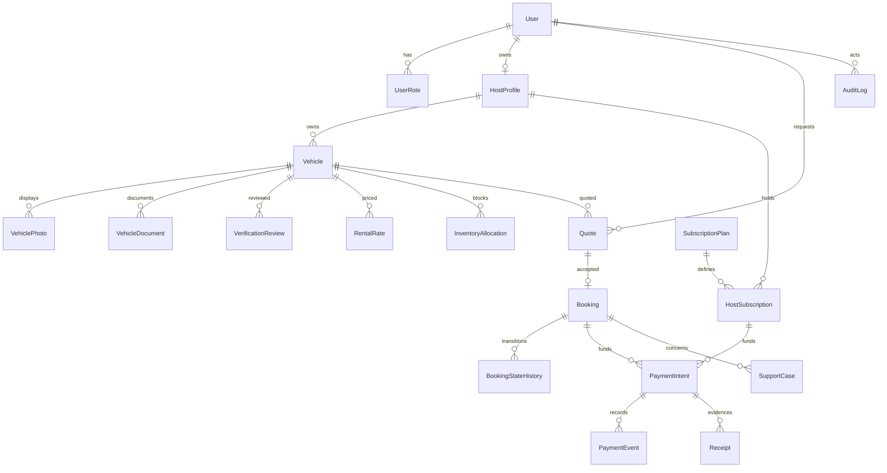

# Proposed domain model and invariants

## Phase 1 implemented subset

Implemented in prisma/schema.prisma and migration 202610290001_identity: User, Session, Account (Better Auth credentials/provider accounts), Verification, TwoFactor, RoleAssignment, AuditLog and RateLimit. All record IDs default to PostgreSQL-generated UUID text. User email, session token, provider/account identity, user/role assignment and throttle key have unique constraints; related auth records have explicit foreign keys. TwoFactor includes enrollment verification and lockout fields required by the installed library. CUSTOMER is assigned by an insert trigger; HOST/ADMIN are controlled separately; DRIVER is reserved and denied.

Prisma @updatedAt supplies update timestamps on ORM mutations; database defaults supply creation timestamps. Audit events are append-only via trigger. Actor deletion is consequently restricted when audit history references that actor; account deletion is not enabled in Phase 1. Retention and erasure workflows remain pending qualified policy review rather than silently deleting audit evidence.

The migration contains no fleet, quote, booking or financial tables. The broader ERD below remains a future design. Existing Vehicle and KILIFI_FLEET remain the public catalogue source. Schema changes were applied only to isolated local development/test databases; a separate local restore rehearsal succeeded.

Phase 0 design only, 2026-10-29. No schema or migration created. Existing model is only Vehicle in `src/lib/fleet.ts` and its re-export in `src/lib/types/vehicle.ts`.

Relations are conceptual, not an approved schema. PaymentIntent must reference exactly one payable subject (booking or subscription) with enforced integrity; avoid unchecked polymorphic strings. Allocation may reference a booking or maintenance block with explicit kind/foreign keys and validation. Notifications/outbox reference durable events and authorized recipients. DriverProfile/Assignment and payout/settlement are deferred until their business models are approved. Invoice and Receipt are distinct if approved accounting requires both.

| Group | Required attributes / integrity |
|---|---|
| User, Role/Permission, Session | Generated stable IDs; unique provider identity; revocation; scoped role grants and grant audit. Phase 1 initial schema only. |
| HostProfile | Unique account association or explicit organization membership model; approval state and review provenance. Customer records remain owned by renter identity. |
| Vehicle | Host foreign key; unique legacy slug mapping; approved public attributes; lifecycle separate from interval availability; no sensitive KYC in public DTO. |
| Photos/documents/reviews | Storage key, media metadata, purpose, access class, reviewer, decision/reason, timestamps and expiry; never public KYC URL by default. |
| RentalRate/PriceRule | Currency, exact amounts, units, effective times and policy version; approval of half-day/full-day rules required. |
| Quote/Booking | Vehicle and renter ownership; start/end; itemized immutable agreed price snapshot; policy version; expiry/status; idempotency key; timestamps. |
| InventoryAllocation/AvailabilityBlock | Vehicle, half-open timestamp range, reason/kind and blocking state; one exclusion domain across rentals, maintenance and active holds. |
| BookingStateHistory | Append-only actor, old/new state, timestamp, reason; updated atomically with booking. |
| PaymentIntent/Transaction/Event | Payable subject, currency/amount, provider correlation, unique external event/transaction identifiers, status and reconciled evidence; financial events immutable. |
| SubscriptionPlan/HostSubscription | Versioned limits/price; approved billing interval; effective/expiry dates and policy; activation tied to reconciled payment or audited override. |
| Invoice/Receipt/Settlement | Immutable financial references and adjustments; settlement only if platform funds collection approved. No invented payout balances. |
| SupportCase/Notification/AuditLog | Actor/recipient, linked resource, timestamps, reason and minimum necessary data; protected access and retention. |

Cross-cutting invariants: referential integrity; start < end; finite nonnegative approved money units; no confirmed overlapping allocation; ownership checks on every read/mutation; no client-authoritative totals; no successful payment from browser state; no deletion of financial history as ordinary editing; no stale static fallback after authoritative cutover. Real records require provenance. Migration seeds are synthetic/non-production only; existing fleet data needs owner review before any production import.
