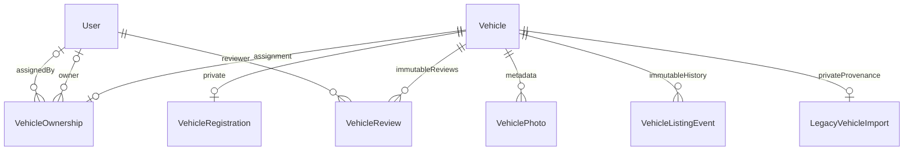
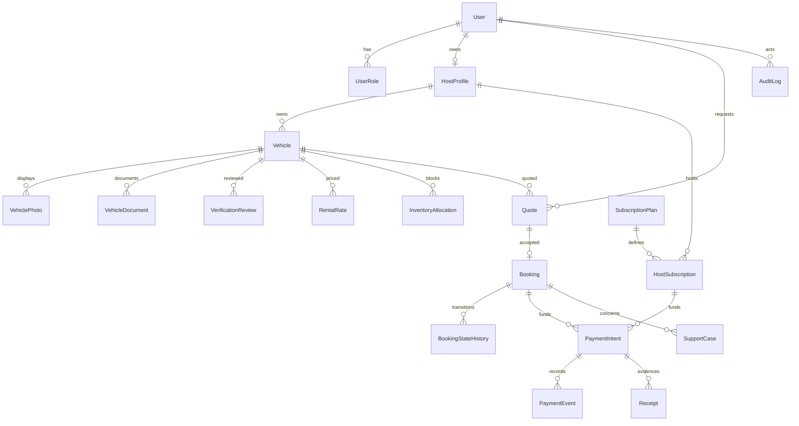

# KiliRide domain model and invariants

## Phase 2E administrator verification (2026-10-31)

Additive migrations `202610300004_vehicle_verification` and `202610300005_verification_requirements` add two tables and policy matrix JSON. Six migrations now produce 19 public tables including Prisma history and 18 application triggers. No historical review was backfilled with invented evidence.

| Record | Fields / invariants |
|---|---|
| VehicleVerificationPolicy | Version PK, reference, approving administrator FK, approval timestamp, enabled flag (default false), testOnly flag (default false), nullable requirements JSON. Policy metadata and matrix are immutable; new content requires a new version. Delete forbidden. An enabled record with missing/unresolved matrix cannot authorize a new approval. Test-only inserts are restricted to kiliride_test; application use also requires port 55433. No real policy is seeded. |
| Compliance matrix JSON | Bounded profiles: jurisdiction, classification, intended use, rental arrangement, ownership/operation; uniquely named requirements with applicability, supporting authority, evidence type, applicability basis and review status. All mandatory requirements need evidence; unresolved applicability/review blocks approval. NOT_APPLICABLE must have confirmed documented authority/basis. |
| VehicleDecisionRecord | DB UUID PK; Vehicle, User reviewer, optional unique VehicleReview and policy FKs; previous/new status, vehicleRevision, reason, optional private evidence ref, checklist JSON and timestamp. Unique (vehicleId, vehicleRevision). Append-only, no update/delete. Approval checklist contains five checks plus explicit context attestation, mandatory compliance evidence and immutable applicable-profile snapshot. |

The decision engine locks Vehicle, checks expected revision and existing lifecycle authorization, validates enabled approved policy, full saved listing, five confirmations, resolved matching profile, required evidence and readable ACTIVE photographs. It creates VehicleReview where applicable, decision record, status/revision update, listing event and AuditLog atomically. SQL independently enforces independent MFA reviewer/current state/revision, matching review, policy, checklist, compliance evidence/profile snapshot and immutable history. Replays/conflicting decisions cannot both succeed. Policy locks prevent concurrent disabling during decision commit.

Supporting evidence remains private text references, not public URLs or file uploads. Only ADMIN DTOs include verification evidence. HOST feedback selects outcome, reason and time; no reviewer identity, policy/evidence or object-storage metadata. Public catalogue still uses static KILIFI_FLEET, not these records.

The product-provided [0.1-DRAFT policy](policies/KILIRIDE_VEHICLE_VERIFICATION_V0_1_DRAFT.md) has no approver/effective date and is **not** inserted as an approved policy. Its unresolved matrix is represented in `src/lib/config/vehicle-verification-draft.ts`. The table is for formally authorized policy records; technical ADMIN registration alone is not proof of business authorization. Formal activation and legal/insurance determinations remain deployment blockers. Earlier sections below document the model at their stated milestone.

## Phase 2D image journal and photo invariants (2026-10-30)

`202610300003_vehicle_images` adds one table, `VehicleImageObject`, with server-generated key, PENDING/ACTIVE/DELETE_PENDING state, SHA-256, normalized byte size/dimensions and creation time. `VehiclePhoto.objectKey` is a nullable unique FK; old metadata-only rows remain untouched and are never assumed to reference genuine stored photographs. New rows bind `objectKey = storageKey` and `image/webp`; no original filename/path is stored. Photo bytes remain outside PostgreSQL in private local storage.

Upload journal creation commits before filesystem writes. A transaction locks the parent vehicle and journal, writes and flushes bytes, activates the object, adds/replaces photo metadata, increments revision and appends audit. A failed transaction leaves an unreferenced PENDING record for compensation. Replacement preserves photo ID/position/cover but changes the storage object; old-object deletion intent commits with the swap. Deletion removes metadata first, selects a remaining cover and compacts positions atomically; physical removal follows commit and can be retried. Old metadata-only rows have no object to delete.

The existing unique vehicle/position and partial single-cover indexes remain. Ordering validates the complete owned photo set, uses temporary unused positions and assigns one cover in the transaction. The new SQL photo trigger locks its parent, refuses identity/vehicle changes and all pending/approved/suspended mutations, and requires ACTIVE normalized objects for new image links. Every API image mutation checks ownership, HOST role and expected revision. Submitted listing reviews therefore cannot race image edits.

Journal cleanup locks each record and rechecks references/state before deletion. DELETE_PENDING is immediately eligible; PENDING must be over one hour old in the operator reconciler. Active referenced images are retained. Missing/corrupt active storage fails closed at read time and requires approved restore/replacement; it is not silently rewritten into a different listing state. See [local setup](KILIRIDE_LOCAL_SETUP.md) for coordinated backups and retry operations.

## Phase 2C implemented extension (2026-10-30)

`202610300002_host_vehicle_management` adds `VehicleOwnershipOrigin` and `VehicleOwnership.declaredAt`. No new tables or destructive data operations. Existing assigned rows become ADMIN_ASSIGNED while null-owner rows become UNASSIGNED; original assignment fields are retained.

| Origin | Required fields | Meaning |
|---|---|---|
| UNASSIGNED | Owner, declaration and assignment fields null | Legacy/unresolved ownership; absent from every host's inventory. |
| HOST_DECLARED | Session-derived ownerId, declaredAt; administrator/evidence fields null | New listing associated with an existing verified-email HOST account, with no verification claim. Only inserted for a new listing; cannot claim an existing unassigned record. |
| ADMIN_ASSIGNED | Owner, MFA administrator, assignedAt, reason and evidence reference; declaredAt null | Existing controlled administrator assignment path, preserved. |

The ownership constraint/trigger enforces these distinct provenance states; ownership transfer/deletion remains unsupported. New vehicles retain DB-generated internal UUIDs and immutable server-generated `vehicle-<uuid>` public IDs; legacy slugs do not change. Every host create/edit/submit writes an atomic audit event; creation and state changes also append listing history.

Review submission requires saved specifications, positive integer KES prices/seats, description and private registration. Description/registration may be empty while drafting. The database additionally rejects submission without nonblank description/category/registration. This is listing completeness only, not KYC/insurance criteria. Hosts can edit DRAFT or REJECTED; rejected edits return to DRAFT, retaining immutable review history. Only the existing independent MFA-admin service can approve/reject; it has no new HTTP/UI entry point. Public catalogue remains static. Earlier subset descriptions below are historical.

## Phase 2A/2B implemented subset (2026-10-30)

`202610300001_fleet_foundation` adds seven tables without altering identity data. Internal vehicle IDs are DB-generated UUIDs; immutable unique `publicId` preserves legacy slugs. Base prices are positive integer KES; timestamps use timestamptz. Nullable description records missing source information without inventing content.

An ownership record with null ownerId is explicitly UNASSIGNED. Assignment requires an existing verified HOST and recorded MFA ADMIN, reason, evidence reference and timestamp. Transfers are not supported. Review records identify the reviewed revision, independent administrator, criteria/evidence references, decision/reason and time. APPROVED points to a matching current approval review; old review records cannot approve a different vehicle/revision. No approval is imported from static flags.

VehicleRegistration and LegacyVehicleImport are private models, excluded from general vehicle reads. The source JSON retains historical flags, contact/image paths and fee values only as untrusted provenance. There are no photo or review rows for imported vehicles. Photograph storage/validation, document authenticity, verification expiry and approved criteria remain later work. The server-only lifecycle and SQL guards are described in [KILIRIDE_PHASE2_REPORT.md](KILIRIDE_PHASE2_REPORT.md). Broader conceptual models below remain proposals.

## Phase 1 implemented subset

Implemented in prisma/schema.prisma and migration 202610290001_identity: User, Session, Account (Better Auth credentials/provider accounts), Verification, TwoFactor, RoleAssignment, AuditLog and RateLimit. All record IDs default to PostgreSQL-generated UUID text. User email, session token, provider/account identity, user/role assignment and throttle key have unique constraints; related auth records have explicit foreign keys. TwoFactor includes enrollment verification and lockout fields required by the installed library. CUSTOMER is assigned by an insert trigger; HOST/ADMIN are controlled separately; DRIVER is reserved and denied.

Prisma @updatedAt supplies update timestamps on ORM mutations; database defaults supply creation timestamps. Audit events are append-only via trigger. Actor deletion is consequently restricted when audit history references that actor; account deletion is not enabled in Phase 1. Retention and erasure workflows remain pending qualified policy review rather than silently deleting audit evidence.

The migration contains no fleet, quote, booking or financial tables. The broader ERD below remains a future design. Existing Vehicle and KILIFI_FLEET remain the public catalogue source. Schema changes were applied only to isolated local development/test databases; a separate local restore rehearsal succeeded.

Phase 0 design only, 2026-10-29. No schema or migration created. Existing model is only Vehicle in `src/lib/fleet.ts` and its re-export in `src/lib/types/vehicle.ts`.

Relations are conceptual, not an approved schema. PaymentIntent must reference exactly one payable subject (booking or subscription) with enforced integrity; avoid unchecked polymorphic strings. Allocation may reference a booking or maintenance block with explicit kind/foreign keys and validation. Notifications/outbox reference durable events and authorized recipients. DriverProfile/Assignment and payout/settlement are deferred until their business models are approved. Invoice and Receipt are distinct if approved accounting requires both.

| Group | Required attributes / integrity |
|---|---|
| User, Role/Permission, Session | Generated stable IDs; unique provider identity; revocation; scoped role grants and grant audit. Phase 1 initial schema only. |
| HostProfile | Unique account association or explicit organization membership model; approval state and review provenance. Customer records remain owned by renter identity. |
| Vehicle | Host foreign key; unique legacy slug mapping; approved public attributes; lifecycle separate from interval availability; no sensitive KYC in public DTO. |
| Photos/documents/reviews | Storage key, media metadata, purpose, access class, reviewer, decision/reason, timestamps and expiry; never public KYC URL by default. |
| RentalRate/PriceRule | Currency, exact amounts, units, effective times and policy version; approval of half-day/full-day rules required. |
| Quote/Booking | Vehicle and renter ownership; start/end; itemized immutable agreed price snapshot; policy version; expiry/status; idempotency key; timestamps. |
| InventoryAllocation/AvailabilityBlock | Vehicle, half-open timestamp range, reason/kind and blocking state; one exclusion domain across rentals, maintenance and active holds. |
| BookingStateHistory | Append-only actor, old/new state, timestamp, reason; updated atomically with booking. |
| PaymentIntent/Transaction/Event | Payable subject, currency/amount, provider correlation, unique external event/transaction identifiers, status and reconciled evidence; financial events immutable. |
| SubscriptionPlan/HostSubscription | Versioned limits/price; approved billing interval; effective/expiry dates and policy; activation tied to reconciled payment or audited override. |
| Invoice/Receipt/Settlement | Immutable financial references and adjustments; settlement only if platform funds collection approved. No invented payout balances. |
| SupportCase/Notification/AuditLog | Actor/recipient, linked resource, timestamps, reason and minimum necessary data; protected access and retention. |

Cross-cutting invariants: referential integrity; start < end; finite nonnegative approved money units; no confirmed overlapping allocation; ownership checks on every read/mutation; no client-authoritative totals; no successful payment from browser state; no deletion of financial history as ordinary editing; no stale static fallback after authoritative cutover. Real records require provenance. Migration seeds are synthetic/non-production only; existing fleet data needs owner review before any production import.
